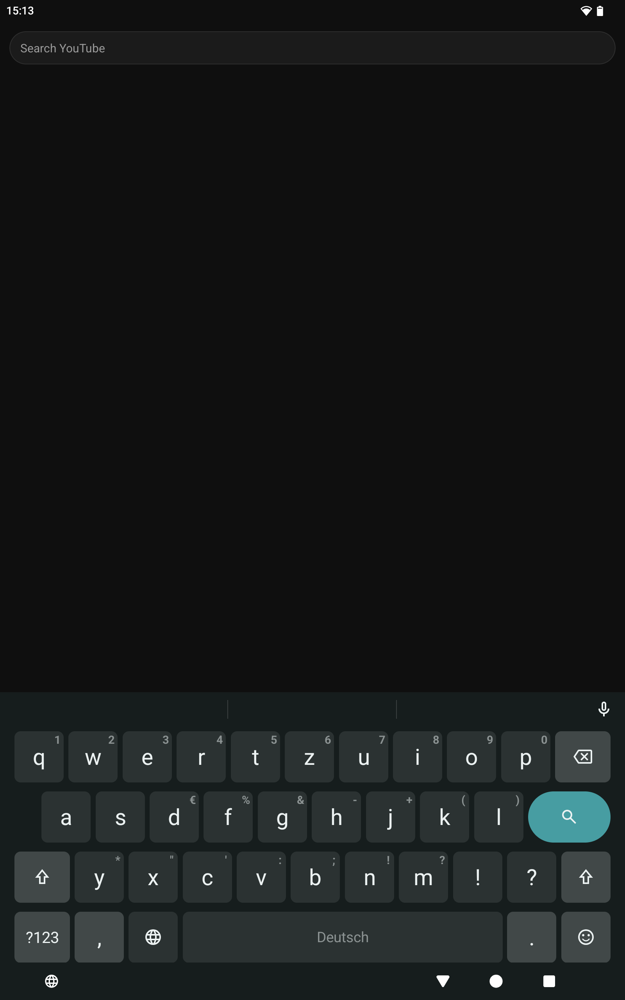
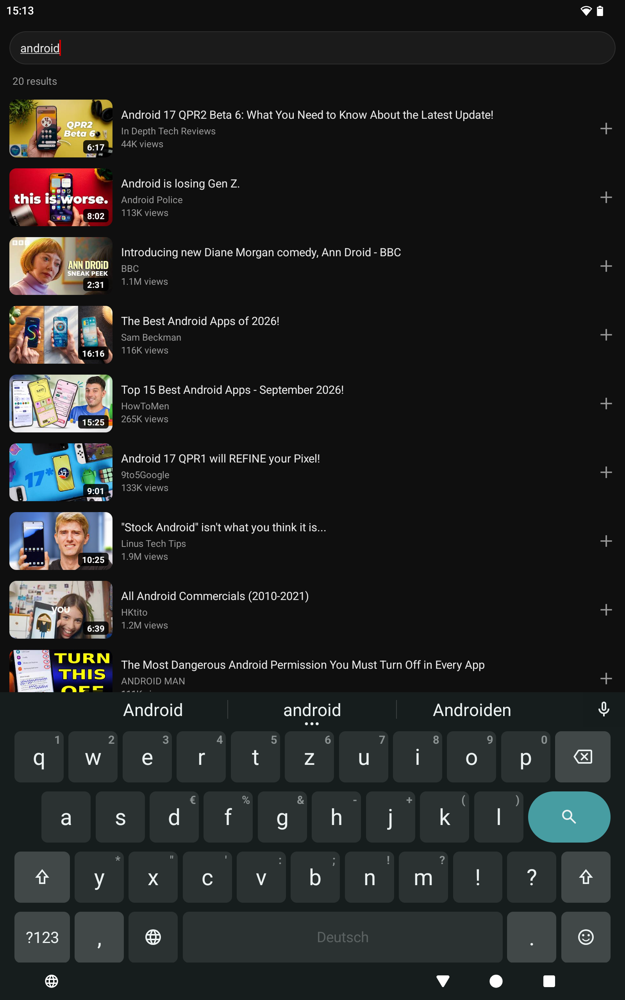

# Tiny Tube 📺

A small, focused YouTube client for Android. It uses Android's built-in media codecs and keeps the feed, playback, and offline videos in one compact app.

## ✨ What it does

- **A quiet feed:** channel updates appear without refresh spinners. Filter ready, unwatched, all, or downloaded videos.
- **Fast playback:** video and audio heads are cached on Wi-Fi so recent videos can start quickly. Resume where you left off.
- **Offline viewing:** download videos with their audio and SponsorBlock segments; optionally keep a channel's next unwatched videos ready.
- **Simple controls:** fullscreen landscape player, seeking, brightness, volume, and playback speed gestures.
- **Search and links:** search YouTube, add a result to the feed, subscribe to a channel, or open a shared YouTube link.

## 📸 Screenshots

| Search | Results |
| --- | --- |
|  |  |

## Install and updates 📦

Download an APK from [GitHub Releases](https://github.com/jarvis-jhk/tiny-tube/releases). To get future releases in [Obtainium](https://github.com/ImranR98/Obtainium), use [Add to Obtainium](https://apps.obtainium.imranr.dev/redirect?r=obtainium://add/https://github.com/jarvis-jhk/tiny-tube) or paste `https://github.com/jarvis-jhk/tiny-tube` into Obtainium's Add App screen.

The public app has package ID `org.tinytube.app`. It is a separate installation from any personal build, and its updates must be signed by the same release key. Android 14 or newer is required.

## 🛠️ Build from source

Run `./build.sh` on Linux. It downloads a JDK and Android SDK tools into `.tools/` if needed, then produces `tiny-tube.apk`. No Gradle, AndroidX, Kotlin, or third-party runtime libraries are needed. A local build creates a disposable signing key; keep your own key if you want to install updates over it.

The public source starts with an empty channel list. Search for a video, then long-press its plus button to subscribe to its channel. No account login is supported.

## Privacy

The public app contains no preset subscriptions, personal service domains, phone/tablet synchronization, backup or restore integration, or automatic crash uploads. Your subscriptions, history and downloaded videos stay in the app's local storage. It connects to YouTube for videos and search, thumbnail servers for images, and SponsorBlock for skip segments. Android may remove local data when you uninstall the app.

## Issues and contributions

Use [Issues](https://github.com/jarvis-jhk/tiny-tube/issues) for reproducible faults and focused improvements. Include app and Android versions, and remove personal information from diagnostics. See [CONTRIBUTING.md](CONTRIBUTING.md) for scope and release review rules. Every public update is reviewed separately before release.

## 🎯 Scope

Tiny Tube intentionally focuses on a subscription feed, search, playback, and downloads. It does not offer comments, playlists, subtitles, casting, background audio, or support for sites other than YouTube. YouTube protocol changes can interrupt playback until the extractor is updated.

This is an independent client, not affiliated with YouTube or Google. SponsorBlock segments come from [SponsorBlock](https://sponsor.ajay.app/).

## License

Tiny Tube is distributed under the GNU General Public License version 3 (GPL-3.0-only); see [LICENSE](LICENSE). Its YouTube client constants and player request shape were adapted from [PipePipeExtractor](https://github.com/InfinityLoop1308/PipePipeExtractor), which uses GPLv3. The VISIONOS client values were informed by [yt-dlp](https://github.com/yt-dlp/yt-dlp), whose source is released under the Unlicense.
